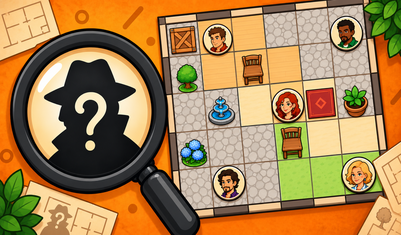

  

  
  

  <a href="#selected-work">Selected work</a> ·
  <a href="#contact">Contact</a>

I'm **Darya Ulyanova**, a game developer working in **Unity and C#** and building browser games with **TypeScript and PixiJS**. I work on gameplay, interactive objects, UI, animation, and effects that respond to the player.

  
  
  
  
  

## Selected work

`01 / SELECT GAME`

### Detective: Clues and Puzzles

**Browser puzzle · Developed for DRA**

Use clues to place characters on the map and reconstruct the scene.

**[▶ Play on Yandex Games](https://yandex.ru/games/app/detektiv-zagadki-i-tainy-623305?lang=en)**

Cover art · DRA

### Gacha Shop Simulator

I work on the development team for **Meriin Media**, where I build and improve gameplay systems and UI and integrate new features into the game.

[Steam page](https://store.steampowered.com/app/4417480/Gacha_Shop_Simulator/) · [Steam demo](https://store.steampowered.com/app/4893610/Gacha_Shop_Simulator_Demo/)

Official Steam cover · Meriin Media

### Late Night Order

**One-week Unity test assignment**

A short first-person prototype set in a late-night café. It combines coffee preparation, environmental interactions, and branching dialogue.

**Unity · C# · Interactions · Dialogue & sequences**

[Project overview and source code](https://github.com/Tb-Integral/LateNightOrder#readme)

Prototype screenshots

## Projects I contributed to

**Dino Island / Dino Island 2** — I took part in development as a member of an external contractor's team.

- **Dino Island:** [Google Play](https://play.google.com/store/apps/details?id=com.amayasoft.dinosaur.games.little.kids.toddlers) · [App Store](https://apps.apple.com/us/app/dinosaur-games-for-kids-dino/id1365354509)
- **Dino Island 2:** [Google Play](https://play.google.com/store/apps/details?id=com.amayasoft.dinosaurs.educational.games.kids.toddlers) · [App Store](https://apps.apple.com/us/app/games-for-toddlers-kids-2-5/id1443715499)

## What I bring to a team

My previous commercial experience includes working in a contractor's team on existing 2D children's games: integrating scenes and prefabs, implementing mini-games and drag-and-drop interactions, adapting UI to mobile screen sizes, and fixing gameplay bugs.

- **Gameplay & integration:** Unity, C#, prefabs, interactive objects, UniTask, and VContainer.
- **UI & localization:** mobile layouts, TextMeshPro, and I2 Localization.
- **Animation & feedback:** Animator, Spine, Timeline, DOTween, and synchronizing VFX and audio with gameplay.

More projects & learning

- **[BigShotDrive!](https://github.com/Tb-Integral/BigShotDrive-)** — a Unity driving and shooting project with AI traffic, a shop, scoring, and saved progress.
- **[TANKS!](https://github.com/Tb-Integral/Tanks)** — a top-down tank project with local players and AI, rounds, win tracking, and RU/EN language selection.
- **[Ruby's Adventures](https://github.com/Tb-Integral/RubysAdventures)** — a Unity Learn project using Input System and UI Toolkit, with movement, shooting, dialogue, and health.
- **[Unity Play profile](https://play.unity.com/en/user/7df1ab4e-d89c-44ad-a9ae-82964ba5e688)** · **[Unity Learn profile](https://learn.unity.com/u/68d39755edbc2a06c9771d1c?tab=profile)**

## GitHub stats

  
  

Updated daily from public GitHub data. Private projects and GitLab work are not included; language shares reflect code volume, not proficiency.

## Contact

For game development opportunities and collaboration:

**[dariaulyanova06@gmail.com](mailto:dariaulyanova06@gmail.com)** · **[@integral5025](https://t.me/integral5025)**
