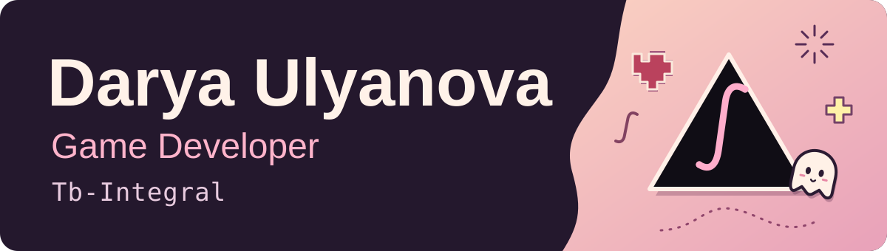
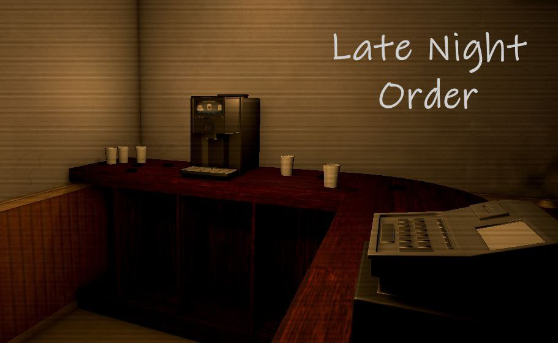
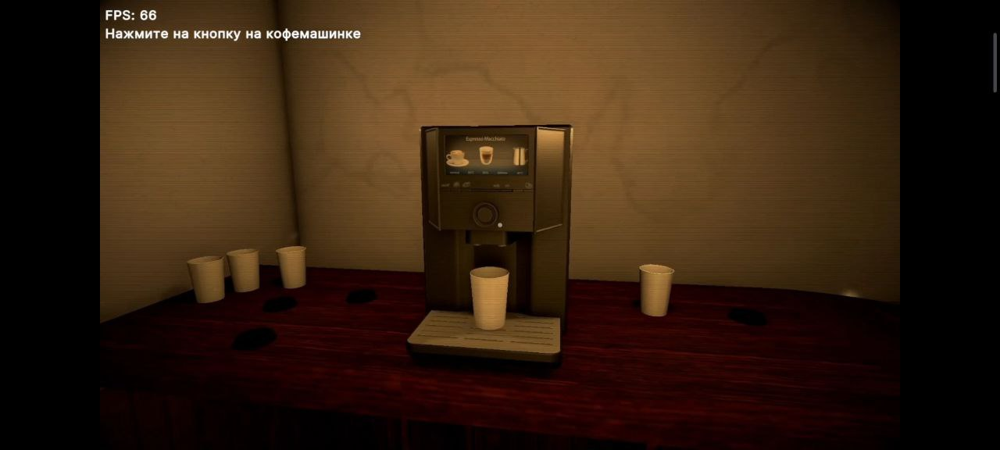
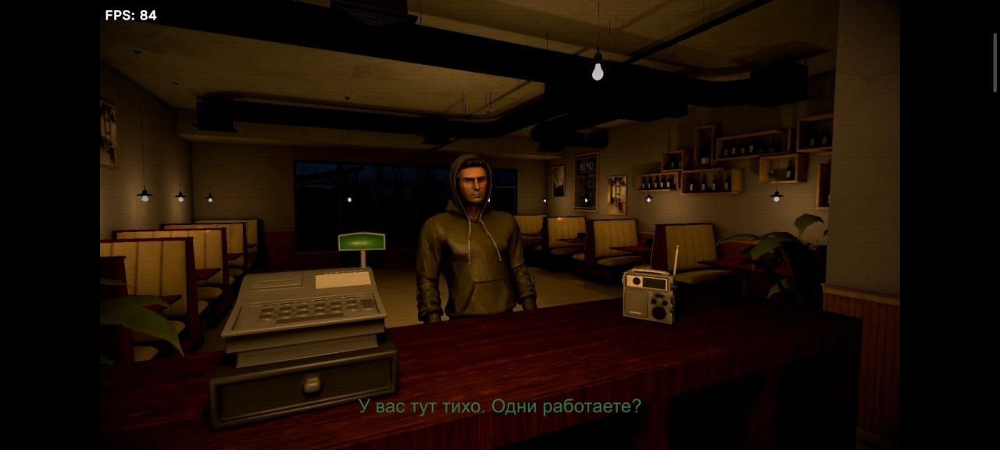

  

  <a href="https://store.steampowered.com/app/4417480/Gacha_Shop_Simulator/">Current team project</a> ·
  <a href="#selected-work">Selected work</a> ·
  <a href="mailto:dariaulyanova06@gmail.com">Get in touch</a>

I'm **Darya Ulyanova**, a game developer working with **Unity and C#**, as well as browser games with **TypeScript and PixiJS**.

I work on gameplay and on the details around it: responsive interfaces, interactive objects, animation sequences, and effects that respond to the player's actions.

## Currently working on

**[Gacha Shop Simulator](https://store.steampowered.com/app/4417480/Gacha_Shop_Simulator/)** — working as a developer on the team. A shop simulation game by **Meriin Media**, with a [free demo on Steam](https://store.steampowered.com/app/4893610/Gacha_Shop_Simulator_Demo/).

## What I bring to a team

My previous commercial experience includes working in a contractor's team on existing 2D children's games: integrating scenes and prefabs, implementing mini-games and drag-and-drop interactions, adapting UI to mobile screen sizes, and fixing gameplay bugs.

- **Gameplay & integration:** Unity, C#, prefabs, interactive objects, UniTask, and VContainer.
- **UI & localization:** mobile layouts, TextMeshPro, and I2 Localization.
- **Animation & feedback:** Animator, Spine, Timeline, DOTween, and synchronizing VFX and audio with gameplay.

I also work on browser games with TypeScript and PixiJS.

## Selected work

### 01 / Late Night Order

A horror demo set in a late-night café, built as a test assignment. Its gameplay combines coffee preparation, interactions with the environment, a tutorial, dialogue branches, and two endings.

This project brings together gameplay systems and scripted sequences in a compact playable experience.

**Unity · C# · Interactions · Dialogue & sequences**

[Explore the project](https://github.com/Tb-Integral/LateNightOrder)

Gameplay screenshots — coffee preparation & dialogue

### 02 / Run Rich 3D — Gameplay Recreation

A Unity test assignment recreating a runner level from a video reference: movement, pickups, character presentation, gates, UI, and win/loss states.

The repository includes setup instructions and PlayMode tests for gameplay and restart behavior. This is a reference-based exercise, not the original commercial game.

**Unity · C# · Gameplay systems · PlayMode tests**

[Explore the project](https://github.com/Tb-Integral/run-rich-3d-test)

More projects & learning

- **[BigShotDrive!](https://github.com/Tb-Integral/BigShotDrive-)** — a Unity driving and shooting project with AI traffic, a shop, scoring, and saved progress.
- **[TANKS!](https://github.com/Tb-Integral/Tanks)** — a top-down tank project with local players and AI, rounds, win tracking, and RU/EN language selection.
- **[Ruby's Adventures](https://github.com/Tb-Integral/RubysAdventures)** — a Unity Learn project using Input System and UI Toolkit, with movement, shooting, dialogue, and health.
- **[Unity Play profile](https://play.unity.com/en/user/7df1ab4e-d89c-44ad-a9ae-82964ba5e688)** · **[Unity Learn profile](https://learn.unity.com/u/68d39755edbc2a06c9771d1c?tab=profile)**

## Contact

For game development opportunities and collaboration: **[dariaulyanova06@gmail.com](mailto:dariaulyanova06@gmail.com)**.
